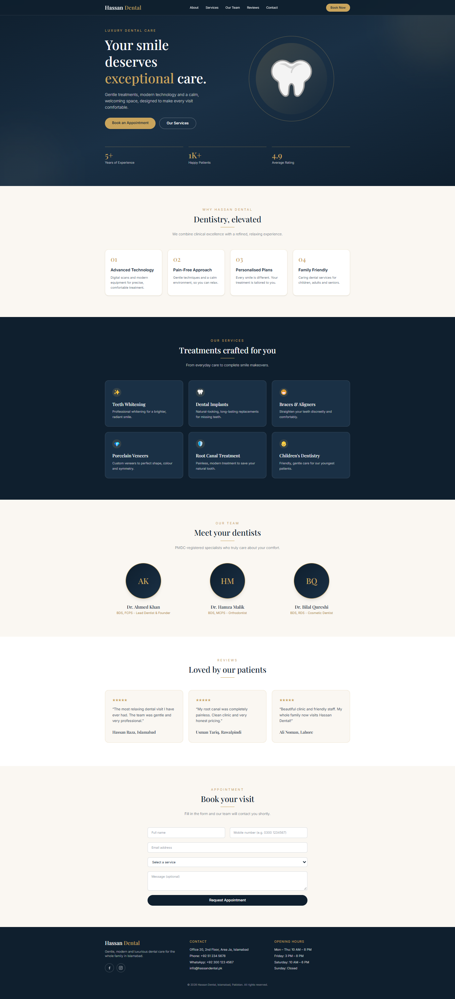

# Hassan Dental Website

**Live Demo:** [hassan-dental-two.vercel.app](https://hassan-dental-two.vercel.app/)




A modern, luxury-style one-page website for a dental clinic in Islamabad, Pakistan.
Built with React, Vite and Tailwind CSS. This is a frontend-only project (no backend).

## Features

- Responsive design (mobile, tablet, desktop)
- Sticky navbar with mobile menu
- Sections: Hero, About, Services, Team, Reviews, Appointment, Footer
- Appointment form sends the details to the clinic's WhatsApp
- Facebook and Instagram links in the footer

## Tech Stack

- React 18
- Vite 6
- Tailwind CSS 4

## Getting Started

Requirements: Node.js 18 or newer.

```bash
# 1. Install dependencies
npm install

# 2. Create your .env file (see below)
cp .env.example .env

# 3. Start the development server
npm run dev
```

Open the link shown in the terminal (usually http://localhost:5173).

## Environment Variables

Create a `.env` file in the project root:

```
VITE_WHATSAPP_NUMBER=923001234567
```

Use the clinic's number with the country code, digits only (no `+`, no spaces, no leading 0).
Example: `0312 3456789` becomes `923123456789`.

Restart `npm run dev` after changing `.env`.

## Scripts

| Command           | What it does                  |
| ----------------- | ----------------------------- |
| `npm run dev`     | Starts the development server |
| `npm run build`   | Creates the production build  |
| `npm run preview` | Previews the production build |

## Project Structure

```
src/
  main.jsx
  App.jsx
  index.css
  components/
    Navbar.jsx
    Hero.jsx
    About.jsx
    Services.jsx
    Team.jsx
    Testimonials.jsx
    Appointment.jsx
    Footer.jsx
    SectionTitle.jsx
```

## Customization

- **Clinic name, address, phone, hours, social links:** `src/components/Footer.jsx` and `src/components/Navbar.jsx`
- **Services:** `src/components/Services.jsx`
- **Doctors:** `src/components/Team.jsx`
- **Patient reviews:** `src/components/Testimonials.jsx`
- **Stats (years, patients, rating):** `src/components/Hero.jsx`
- **Colors and fonts:** `src/index.css` (the `@theme` block)

All names, numbers and addresses in this project are sample data.


